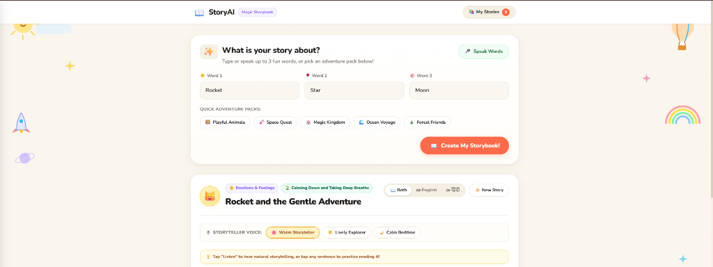

# StoryAI

StoryAI is an assistive bilingual storytelling and literacy platform tailored for early readers, neurodivergent children, and learners in special education. The application accepts prompt words via text, single-tap theme packs, or microphone speech recognition, synthesizes structured educational narratives via Groq LLM inference, and formats the output side-by-side in English and Hindi. Integrated speech synthesis delivers natural storytelling audio synchronized with sentence-by-sentence spotlight highlighting to support comprehension, pronunciation, and reading pacing.



---

## Table of Contents

- [Overview](#overview)
- [Support for Children with Special Needs](#support-for-children-with-special-needs)
- [Interface Proof](#interface-proof)
- [Key Features](#key-features)
- [Technology Stack](#technology-stack)
- [Installation and Setup](#installation-and-setup)
- [Configuration](#configuration)
- [Running the Application](#running-the-application)
- [API Reference](#api-reference)
- [Testing and Verification](#testing-and-verification)
- [Deployment](#deployment)
- [License](#license)

---

## Overview

StoryAI combines generative language models with assistive multimodal speech technology to generate personalized, accessible narratives. Supplying up to three prompt words generates a complete story centered on essential developmental and emotional regulation skills (e.g., calming down, asking for help, patience, task focus).

Each story contains:
1. Title, character identifier, and developmental skill classification.
2. English narrative paragraph structured with sensory details and age-appropriate vocabulary.
3. Natural, conversational Hindi translation aligned for bilingual comprehension.
4. Interactive reflection question linking the narrative theme to real-world social-emotional situations.
5. Synchronized sentence-level speech narration with active spotlight highlighting.

---

## Support for Children with Special Needs

StoryAI was architected specifically to overcome common reading and developmental barriers faced by neurodivergent children and special education students:

- **Visual Pacing and Attention (ADHD & Executive Functioning)**: Children with attention challenges often feel overwhelmed by dense blocks of text. The live yellow spotlight highlights only one sentence at a time as it is spoken, reducing visual crowding and guiding sustained focus across the page.
- **Multisensory Auditory Reinforcement (Dyslexia & Reading Delays)**: Presenting synchronized auditory speech alongside highlighted text connects phonemes with graphemes in real time. Children can also tap any individual sentence to replay its pronunciation on demand without restarting the story.
- **Social-Emotional Scaffolding (Autism Spectrum / ASD)**: Children on the autism spectrum benefit from explicit social storytelling. Every generated narrative illustrates a practical coping strategy (such as taking deep breaths when frustrated or asking a friend for assistance) followed by a guided "Think & Share" reflection prompt.
- **Low-Frustration Multimodal Input (Motor & Speech Delay)**: Young learners who struggle with physical keyboard typing can select pre-built adventure theme packs (e.g., Playful Animals, Space Quest) or dictate words via browser speech recognition.
- **Sensory-Friendly Voice Cadence**: The audio engine offers selectable pacing tones (Warm Storyteller at 0.90x, Calm Bedtime at 0.84x, and Lively Explorer at 0.98x) with gentle transitions and a calm color palette to prevent sensory overload.
- **Bilingual Language Development**: Provides authentic British English (`en-GB`) and native Indian Hindi (`hi-IN`) pronunciation, supporting dual-language households and children receiving bilingual speech therapy.

---

## Interface Proof

### Main Application Dashboard
The primary interface provides high-contrast, rounded inputs, theme adventure packs, and storyteller voice selections designed for young learners.


### Synchronized Read-Along Sentence Highlighting
During audio playback, the system dynamically shifts the warm yellow highlight from sentence to sentence in lockstep with the voice, maintaining exact tracking across both English and Devanagari Hindi text.


---

## Key Features

- **Side-by-Side Bilingual Stories**: Concurrent English and Hindi narrative generation mapped to social-emotional skills.
- **Sentence-Level Audio Sync**: Custom sentence queue advances read-along highlight precisely with audio completion.
- **Tap-to-Hear Sentences**: Interactive sentence spans allow learners to practice reading difficult clauses independently.
- **Authentic Voice Accents**: British English storytelling accent and native Indian Hindi neural audio streaming.
- **Storyteller Tone Controls**: Adjustable playback rates (0.84x to 0.98x) suited for bedtime reading or active classroom practice.
- **Local Storage Bookshelf**: Built-in drawer stores up to 20 past stories locally with instant retrieval and deletion.
- **Deterministic Offline Fallback**: Generates structured bilingual stories even when offline or without external API keys.

---

## Technology Stack

### Frontend
- **Framework**: React 19 + Vite 8
- **Typography**: Nunito, Quicksand (High-legibility rounded fonts)
- **Styling**: Vanilla CSS (4px grid, tactile cards, responsive split layouts)
- **Speech APIs**: Web Speech API (`SpeechRecognition`, `SpeechSynthesis`), HTMLAudioElement, Blob streaming
- **HTTP Client**: Axios

### Backend
- **Runtime**: Node.js (v18+) + Express
- **AI Inference**: Groq SDK (`llama-3.3-70b-versatile`)
- **Speech Streaming**: Clause-chunked multi-tier audio streamer (`tl=en-gb` and `tl=hi`)
- **Database (Optional)**: MongoDB Atlas with automated in-memory fallback
- **Test Framework**: Node.js Native Test Runner (`node:test`, `node:assert`)

---

## Installation and Setup

### 1. Clone the repository
```bash
git clone https://github.com/Mrvikas06/StoryAi.git
cd StoryAi
```

### 2. Install dependencies
```bash
npm install
npm install --prefix backend
npm install --prefix frontend
```

### 3. Verify health
```bash
npm run health-check
```

---

## Configuration

Create a `.env` file in the root or `backend/` directory:

```bash
cp .env.example .env
```

| Variable | Description | Required | Default |
|:---|:---|:---|:---|
| `PORT` | Express server port | No | `4000` |
| `NODE_ENV` | Environment mode (`development` / `production`) | No | `development` |
| `GROQ_API_KEY` | Groq Console API Key | No | Built-in fallback |
| `MONGODB_URI` | MongoDB Atlas URI | No | In-memory store |
| `ALLOWED_ORIGINS` | Permitted CORS origins | No | `localhost:3000, 5173` |
| `VITE_API_BASE_URL` | API base URL consumed by frontend | No | `/api` |

---

## Running the Application

### Development Mode (Concurrent)
```bash
# Terminal 1: Backend API (port 4000)
npm run dev:backend

# Terminal 2: Frontend client (port 5173)
npm run dev:frontend
```
Open `http://localhost:5173` in your browser.

### Unified Production Mode
```bash
npm run build
npm start
```
Access the application at `http://localhost:4000`.

---

## API Reference

| Endpoint | Method | Payload / Params | Description |
|:---|:---|:---|:---|
| `/api/health` | `GET` | None | Returns server health and timestamp |
| `/api/story/generate` | `POST` | `{ words: string[], childId?: string }` | Generates structured bilingual story |
| `/api/tts/speak` | `POST` | `{ text: string, lang: 'en' \| 'hi' }` | Streams binary `audio/mpeg` speech buffer |
| `/api/stories/:childId` | `GET` | `childId` in URL | Fetches persisted story collection |
| `/api/stories/:id` | `DELETE` | Story `_id` in URL | Deletes specified story record |

---

## Testing and Verification

Run the automated backend test suite:
```bash
npm test
```

### Coverage Scope:
- Multi-word prompt construction and schema formatting
- Fallback bilingual narrative generation without API credentials
- Emoji sanitization for text-to-speech audio streams
- Clause chunking for long narrations
- Live endpoint responses (`/api/health`, `/api/story/generate`, `/api/tts/speak`)

---

## Deployment

- **Render**: Blueprint ready via `render.yaml` (`npm install && npm run build` -> `npm start`).
- **Vercel**: Serverless routing configured via `vercel.json` pointing `/api` endpoints and `frontend/dist`.
- **Cloudflare Pages**: Manifest configured in `wrangler.toml` for static client hosting.

---

## License

This project is licensed under the MIT License.
