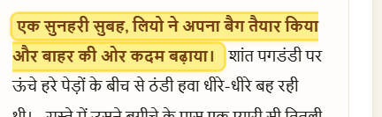

# StoryAI

StoryAI is an accessible bilingual storytelling platform designed for children, early readers, and special education learners. The application accepts prompt words through typing or microphone speech recognition, synthesizes structured educational narratives via Groq LLM inference, and formats the output side-by-side in English and Hindi. Integrated speech synthesis delivers clear neural audio narration and interactive sentence-by-sentence read-along highlighting, guiding children through pronunciation, sentence structure, and comprehension.

---

## Table of Contents

- [Overview](#overview)
- [Key Features](#key-features)
- [Technology Stack](#technology-stack)
- [System Architecture](#system-architecture)
- [Directory Layout](#directory-layout)
- [Prerequisites](#prerequisites)
- [Installation and Setup](#installation-and-setup)
- [Configuration](#configuration)
- [Running the Application](#running-the-application)
- [API Reference](#api-reference)
- [Testing and Quality Assurance](#testing-and-quality-assurance)
- [Deployment Options](#deployment-options)
- [Screenshots](#screenshots)
- [License](#license)

---

## Overview

StoryAI combines generative language models with assistive speech technology to create personalized, encouraging reading material. When supplied with up to three prompt words, the system constructs a narrative centered around essential developmental skills such as emotional regulation, cooperation, task focus, or seeking help.

Each generated story features:
1. Title, character emoji identifier, and developmental skill classification.
2. English narrative paragraph structured with accessible vocabulary and sensory descriptions.
3. Natural, conversational Hindi translation aligned with young comprehension.
4. Interactive reflection question linking the narrative theme to personal experience.
5. Audio narration engine with sentence-by-sentence visual read-along tracking and adjustable playback speed.

---

## Key Features

- **Child-Centered User Experience**: Warm, tactile storybook design utilizing high-legibility rounded typography (Nunito, Quicksand) with high contrast and generous line spacing.
- **Bilingual Story Generation**: Concurrent generation of English and Hindi narratives mapped to specific life skills.
- **Interactive Sentence Read-Along**: Visual spotlight tracking highlights each sentence as it is spoken, assisting reading pacing and comprehension.
- **Sentence-Level Audio Interaction**: Children can tap any individual sentence in English or Hindi to listen to its pronunciation on demand.
- **Adjustable Speech Rate**: Dual-mode playback offering gentle learning pacing (0.85x) and standard narrative pacing (1.0x).
- **Multi-Tier Audio Architecture**: Primary MP3 audio stream synthesized via Google Speech endpoint with zero-latency browser Web Speech API fallback.
- **Multimodal Prompting**: Accepts typed entries, quick adventure theme packs, or spoken voice input via browser SpeechRecognition.
- **Local Bookshelf Drawer**: Stores generated stories in local storage with instant recall and deletion controls.
- **Zero-Dependency Fallback Engine**: Deterministic narrative generation ensures stories generate even without internet or API keys.

---

## Technology Stack

### Frontend
- **Framework**: React 19
- **Build Tool**: Vite 8
- **Typography**: Nunito, Quicksand
- **Styling**: Vanilla CSS with strict 4px spacing scale and responsive storybook cards
- **Audio & Voice APIs**: Web Speech API (`SpeechRecognition`, `SpeechSynthesis`), HTMLAudioElement, Blob API
- **HTTP Client**: Axios

### Backend & Serverless
- **Runtime**: Node.js (v18.0.0 or higher)
- **Web Framework**: Express 5 / Express 4
- **AI Inference**: Groq SDK (`llama-3.3-70b-versatile`)
- **Speech Synthesis Engine**: Multi-tier audio streamer with automatic clause chunking
- **Database (Optional)**: MongoDB Atlas via Mongoose
- **Deployment Handlers**: Vercel Serverless Functions, Render Web Service, Cloudflare Pages

---

## System Architecture

```
+-------------------------------------------------------------------+
|                        Client Application                         |
|  - React 19 + Vite Frontend                                       |
|  - Sentence Read-Along Highlighter & Adjustable Speed (0.85x/1.0x)|
|  - SpeechRecognition (Voice Input) & SpeechSynthesis Fallback     |
|  - Local Storage Story Library                                    |
+---------------------------------+---------------------------------+
                                  |
               HTTP REST Requests | (JSON / Audio Blob)
                                  v
+-------------------------------------------------------------------+
|                     Backend Server / API Gateway                  |
|  - Express Server / Vercel Serverless Functions                   |
|  - Dynamic CORS & Pre-Deployment Verification                     |
+-----------------+-------------------------------+-----------------+
                  |                               |
                  v                               v
    +---------------------------+   +---------------------------+
    |   Groq LLM Inference      |   |   Audio Synthesis Stream  |
    |  - llama-3.3-70b          |   |  - Automatic Clause Split |
    |  - Structured Prompts     |   |  - Google Speech Stream   |
    |  - Local Fallback Engine  |   |  - Automated Temp Cleanup |
    +-------------+-------------+   +---------------------------+
                  |
                  v (Optional)
    +---------------------------+
    |      MongoDB Atlas        |
    |  - Story Persistence      |
    |  - In-Memory Fallback     |
    +---------------------------+
```

---

## Directory Layout

```
StoryAi/
├── api/                         # Vercel serverless function entrypoints
│   ├── health.js                # Health check endpoint
│   ├── story/
│   │   └── generate.js          # Serverless story generation handler
│   └── tts/
│       └── speak.js             # Audio fallback negotiation handler
├── backend/                     # Dedicated Express backend service
│   ├── models/
│   │   └── Story.js             # Mongoose schema and fallback memory store
│   ├── routes/
│   │   ├── stories.js           # Story history retrieval and deletion
│   │   ├── story.js             # Groq prompting, parsing, and fallback engine
│   │   └── tts.js               # Audio streaming and file cleanup
│   ├── temp/                    # Temporary audio storage directory
│   ├── test/
│   │   └── backend.test.js      # Automated unit and integration test suite
│   ├── utils/
│   │   └── ttsService.js        # Audio chunking, synthesis, and garbage collection
│   ├── package.json             # Backend dependencies and scripts
│   └── server.js                # Standalone backend server entrypoint
├── docs/                        # Project documentation and screenshots
│   └── screenshots/             # Interface and read-along proof images
├── frontend/                    # React single-page application
│   ├── public/                  # Static assets and redirect rules
│   ├── src/
│   │   ├── components/
│   │   │   ├── StoryDisplay.jsx # Interactive storybook with sentence highlighter
│   │   │   └── WordInput.jsx    # Kid-friendly prompt builder and voice input
│   │   ├── hooks/
│   │   │   ├── useTTS.js        # Read-along sentence tracking and audio engine
│   │   │   └── useVoiceInput.js # Microphone speech recognition hook
│   │   ├── api.js               # Centralized Axios client interface
│   │   ├── App.css              # Kid-friendly storybook styling
│   │   ├── index.css            # Global Nunito/Quicksand typography setup
│   │   └── main.jsx             # React DOM entrypoint
│   ├── package.json             # Frontend dependencies and scripts
│   └── vite.config.js           # Vite development and production configuration
├── scripts/
│   ├── health-check.js          # Pre-deployment environment verification
│   └── start-server.js          # Combined production orchestrator
├── package.json                 # Root dependencies and mono-repo scripts
├── render.yaml                  # Render.io blueprint deployment configuration
├── server.js                    # Unified production server (API + Static SPA)
├── vercel.json                  # Vercel routing and build configuration
└── wrangler.toml                # Cloudflare Pages / Workers deployment manifest
```

---

## Prerequisites

- **Node.js**: Version 18.0.0 or higher
- **npm**: Version 9.0.0 or higher
- **Groq API Key (Optional)**: Required for live LLM generation; the built-in deterministic generator activates automatically if omitted.
- **MongoDB URI (Optional)**: Required for remote database persistence; in-memory storage activates automatically if omitted.

---

## Installation and Setup

1. **Clone the repository**:
   ```bash
   git clone https://github.com/Mrvikas06/StoryAi.git
   cd StoryAi
   ```

2. **Install root and service dependencies**:
   ```bash
   npm install
   cd backend && npm install
   cd ../frontend && npm install
   cd ..
   ```

3. **Verify the environment**:
   ```bash
   npm run health-check
   ```

---

## Configuration

Copy `.env.example` to create your local environment file:

```bash
cp .env.example .env
```

| Environment Variable | Description | Required | Default |
|:---------------------|:------------|:---------|:--------|
| `PORT` | HTTP port for the Express server | No | `4000` |
| `NODE_ENV` | Runtime mode (`development` or `production`) | No | `development` |
| `GROQ_API_KEY` | API key from Groq Console | No | Built-in fallback |
| `MONGODB_URI` | Connection URI for MongoDB Atlas | No | In-memory cache |
| `ALLOWED_ORIGINS` | Comma-delimited list of custom CORS origins | No | `localhost:3000, 5173` |
| `RENDER_EXTERNAL_URL`| Deployed Render service hostname | No | `http://localhost:3000` |
| `VITE_API_BASE_URL` | Base API URL consumed by the frontend | No | `/api` |

---

## Running the Application

### Development Mode (Concurrent Services)

Start the backend API server on port 4000:
```bash
npm run dev:backend
```

In a separate terminal, launch the Vite frontend server on port 5173:
```bash
npm run dev:frontend
```

Open your browser at `http://localhost:5173`.

### Unified Production Mode

Build the frontend bundle and serve both the API and client from a single Node.js process:
```bash
npm run build
npm start
```

Access the unified service at `http://localhost:4000`.

---

## API Reference

### 1. Health Status
- **Method**: `GET`
- **Endpoint**: `/api/health`
- **Response**:
  ```json
  {
    "status": "ok",
    "message": "Server is running",
    "timestamp": "2026-11-13T17:45:00.000Z"
  }
  ```

### 2. Generate Story
- **Method**: `POST`
- **Endpoint**: `/api/story/generate`
- **Headers**: `Content-Type: application/json`
- **Body**:
  ```json
  {
    "words": ["puppy", "rainbow", "picnic"],
    "childId": "guest"
  }
  ```
- **Response**:
  ```json
  {
    "success": true,
    "story": {
      "_id": "story_1731519900_abcde",
      "title": "Puppy and the Gentle Adventure",
      "emoji": "🌟",
      "skillType": "Emotions & Feelings",
      "skill": "Calming Down and Taking Deep Breaths",
      "english": "One bright morning, Leo packed his bag with a puppy and stepped outside...",
      "hindi": "एक सुनहरी सुबह, लियो ने अपना बैग तैयार किया और बाहर की ओर कदम बढ़ाया...",
      "question": {
        "en": "When was a time you took a deep breath to feel calm and brave?",
        "hi": "आपने पिछली बार शांत और मजबूत महसूस करने के लिए गहरी सांस कब ली थी?"
      },
      "words": ["puppy", "rainbow", "picnic"],
      "childId": "guest",
      "createdAt": "2026-11-13T17:45:00.000Z"
    }
  }
  ```

### 3. Synthesize Speech
- **Method**: `POST`
- **Endpoint**: `/api/tts/speak`
- **Headers**: `Content-Type: application/json`
- **Body**:
  ```json
  {
    "text": "Welcome to story time, little explorer!",
    "lang": "en"
  }
  ```
- **Response**: Streamed binary `audio/mpeg` payload.

### 4. Fetch Saved Stories
- **Method**: `GET`
- **Endpoint**: `/api/stories/:childId`
- **Response**: Array of persisted story objects.

### 5. Delete Story
- **Method**: `DELETE`
- **Endpoint**: `/api/stories/:id`
- **Response**:
  ```json
  {
    "success": true
  }
  ```

---

## Testing and Quality Assurance

Execute the automated test suite covering prompt construction, structured parsing, fallback behavior, audio clause splitting, and live streaming endpoints:

```bash
npm test
```

### Verified Test Suite Results:
- Prompt builder validation with multi-word inputs
- Structured plain-text parsing into English, Hindi, and question fields
- Fallback narrative generation under missing API credentials
- Emoji stripping for audio streaming compatibility
- Text clause chunking for long narrations
- Binary MP3 synthesis verification
- Temporary file management and cleanup
- Route responses for health checks, story generation, and speech synthesis

---

## Deployment Options

### Option 1: Render.io Web Service
The repository contains a pre-configured `render.yaml` specification for single-process hosting.
1. Connect the GitHub repository in the Render dashboard.
2. Select **Web Service** and choose the `render.yaml` blueprint or set:
   - Build Command: `npm install && npm run build`
   - Start Command: `npm start`
3. Add the optional environment variables (`GROQ_API_KEY`, `MONGODB_URI`).

### Option 2: Vercel (Frontend & Serverless Functions)
The repository contains `vercel.json` configured for zero-configuration deployment.
1. Import the repository into Vercel.
2. Build command: `npm install --prefix frontend && npm run build --prefix frontend`.
3. Output directory: `frontend/dist`.
4. Serverless endpoints are automatically routed from the `/api` directory.

### Option 3: Cloudflare Pages
1. In Cloudflare Pages, connect the repository.
2. Build command: `cd frontend && npm install && npm run build`.
3. Build output directory: `frontend/dist`.
4. Set `VITE_API_BASE_URL` to point to your deployed backend API URL.

---

## Screenshots

### Synchronized Read-Along Sentence Highlighting



*Figure 1: Live read-along sentence tracking with synchronized yellow spotlight highlight during Hindi narration.*

The interface highlights the active sentence with a warm yellow spotlight and synchronized speech synthesis progression, allowing young readers to follow word-by-word and sentence-by-sentence in both English and Hindi.

### Application Interface Layout

```
+-------------------------------------------------------------------------------+
|  StoryAI  [Magic Storybook]                             [My Stories (3)]      |
+-------------------------------------------------------------------------------+
|                                                                               |
|  +-------------------------------------------------------------------------+  |
|  | What is your story about?                                               |  |
|  | Type or speak up to 3 fun words!                         [Speak Words]  |  |
|  |                                                                         |  |
|  | [ Word 1: Puppy      ]  [ Word 2: Rainbow     ]  [ Word 3: Picnic     ] |  |
|  |                                                                         |  |
|  | Quick Adventure Packs: [Playful Animals] [Space Quest] [Magic Kingdom]  |  |
|  |                                                                         |  |
|  |                                                [Create My Storybook!]   |  |
|  +-------------------------------------------------------------------------+  |
|                                                                               |
|  +-------------------------------------------------------------------------+  |
|  | (*) Puppy and the Gentle Adventure       [Gentle Speed] [Both] [English]|  |
|  | [* Emotions & Feelings] [Calming Down]                     [New Story]  |  |
|  |-------------------------------------------------------------------------|  |
|  | English Story            [Listen] | Hindi Story                [Listen] |  |
|  |                                   |                                     |  |
|  | [One bright morning, Leo packed]  | [एक सुनहरी सुबह, लियो ने अपना बैग]  |  |
|  | [his bag with a puppy and stepped]| [तैयार किया और बाहर की ओर बढ़ा।]    |  |
|  |                                   |                                     |  |
|  | (Active sentence glows in yellow as the story is read aloud)            |  |
|  |-------------------------------------------------------------------------|  |
|  | THINK & SHARE                                                           |  |
|  | When was a time you took a deep breath to feel calm and brave?          |  |
|  | आपने पिछली बार शांत और मजबूत महसूस करने के लिए गहरी सांस कब ली थी?      |  |
|  +-------------------------------------------------------------------------+  |
|                                                                               |
+-------------------------------------------------------------------------------+
|  StoryAI — Joyful bilingual stories and read-along narration for young readers|
+-------------------------------------------------------------------------------+
```

---

## License

This project is licensed under the MIT License.
